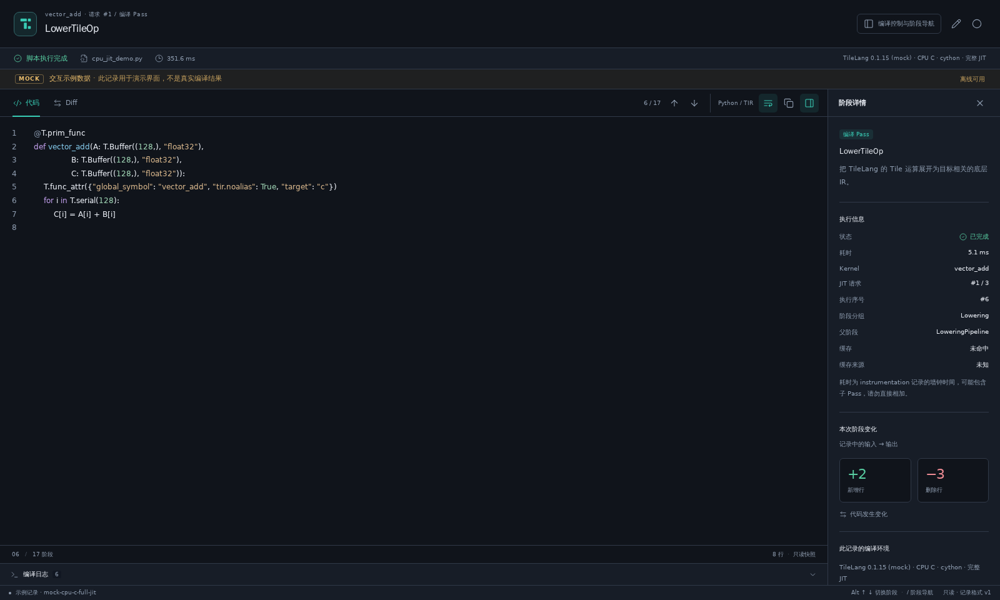
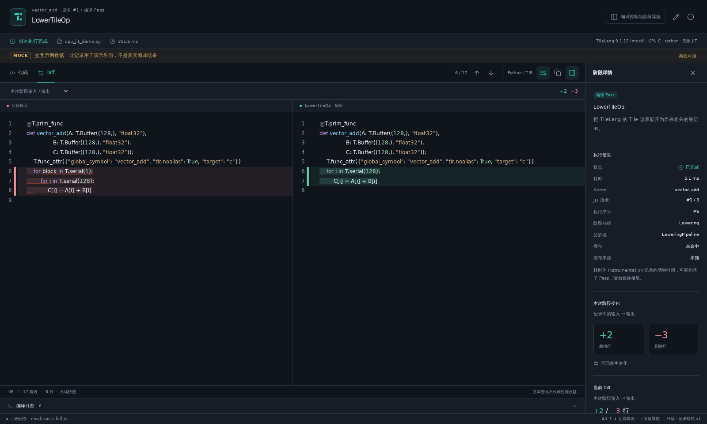

# TileLang DevKit

[English](README.md) | **简体中文**

面向 VS Code 的 TileLang 开发工具。**Lower Trace** 可浏览编译阶段、Lowering Pass、IR 差异、生成代码、日志及缓存复用情况，并支持通过导入导出记录进行离线查看。

这是由 `easy-tilelang` 维护的独立扩展项目，扩展 ID 为 `easy-tilelang.tilelang-devkit-vscode`。插件使用用户选择的 Python 环境加载 TileLang，无需位于编译器仓库内。所有界面资源打包在扩展内。

## 快速开始

1. 在扩展面板中选择 **… → Install from VSIX…** 安装 VSIX 文件。扩展发布后，也可在 Marketplace 中搜索 **TileLang DevKit** 安装。
2. 从命令面板运行 **TileLang DevKit: Open Mock Demo**，浏览阶段输出并切换到 **Diff**。Mock 演示和导入记录无需 Python、TileLang 或网络。
3. 真实采集时，打开 TileLang DevKit 侧栏，选择已保存的 Python 脚本，填写支持环境的 Python 解释器**绝对路径**，点击 **保存并运行**。使用 Remote SSH 时，将扩展安装到远端，并配置远端解释器。

**当前真实采集支持范围：** Linux / Remote SSH，TileLang 0.1.15 的提交 `3e923e98`，CPU C 目标（`target="c"`）及 Cython 后端（`execution_backend="cython"`）。采集包含本地编译、链接和动态库加载。暂不支持其他真实采集后端，也不承诺兼容所有同版本号发行包。桌面 VS Code 离线查看不需要该编译环境。当前界面以中文为主，最低要求 VS Code 1.95。

## 界面预览

以下为内置 **MOCK** 记录的真实浏览器预览，不是真实编译结果。这些图片展示结果视图；编译侧栏和源码编辑器由 VS Code 分别提供。





版本说明见 [CHANGELOG](CHANGELOG.md)。

## 源码开发、打包与安装

构建需要 Node.js 22 或更新版本。VS Code 最低版本为 1.95。在本目录执行：

```bash
npm ci
npm run build
code tilelang-devkit.code-workspace
```

打开提供的工作区后按 **F5**，选择 `Run TileLang DevKit`。在新开的 Extension Development Host 中点击活动栏的 **TileLang DevKit** 图标，打开侧栏配置编译入口，或直接打开 Mock 示例。也可以运行命令 **TileLang DevKit: Open Mock Demo** 浏览明确标记为 `MOCK` 的示例，或用 **TileLang DevKit: Open Lower Trace** 打开空工作台或最近记录。

打包与安装：

```bash
npm run package
code --install-extension tilelang-devkit-vscode-0.1.0.vsix
```

也可以在扩展面板中选择 **Install from VSIX…**。Remote SSH 场景需要将扩展安装到远端；Python 解释器、入口路径和编译任务均在工作区所在主机解析。

只预览界面时可执行 `npm run preview` 并打开 `http://127.0.0.1:4173`，侧栏预览位于 `/sidebar`。这是使用 Mock 桥接的开发演示，不能执行真实编译，也不能代替 VS Code 扩展验收。

## 侧栏配置、导航与中央结果视图

点击活动栏 **TileLang DevKit** 图标，在侧栏选择入口文件、设置 Python 解释器、脚本参数、工作目录和缓存选项，然后点击 **保存并运行**。**使用当前文件** 要求已保存的 `.py` 文件，会清空脚本参数和工作目录；浏览文件和选择当前文件都保留侧栏草稿中的解释器与缓存选项。**CPU 示例** 会保留 Python 路径，设置参数 `["--repeat", "1", "--verify"]`、清空工作目录、开启禁用缓存，并在 VS Code 原生编辑器中打开示例源码。加载示例后需点击 **保存并运行** 执行脚本。**编辑源码** 可再次打开当前入口。

侧栏按实际执行顺序列出所有阶段，可搜索、选择 kernel 或隐藏无变化阶段。同名 Pass 保留独立 ID 和重复序号，缓存命中只显示实际观测的阶段。点击阶段会在源码旁打开或复用中央结果视图，并保持侧栏操作焦点；中央的上一阶段、下一阶段和快捷键会同步侧栏选中状态。筛选只影响导航列表，不改变 Diff 的上一阶段。

中央结果视图展示代码、Diff、可折叠的阶段详情和日志。编译配置、运行与取消、阶段列表及导入导出集中在侧栏，源码编辑继续使用 VS Code 的原生编辑器。没有阶段的脚本错误仍可查看源码快照与日志；点击错误定位会选择可获取的失败阶段并展开诊断。

运行中可浏览已采集阶段或导出当前记录，替换入口、Mock 或导入暂不可用。切换活动栏、隐藏侧栏、关闭中央结果视图均不会取消任务；停止运行请点击侧栏的 **取消**。取消后保留已采集阶段。未信任工作区可浏览 Mock 和离线记录，但不能执行 Python。

## 运行脚本并采集真实 JIT

选用已构建、能够导入上述受支持 TileLang 版本的 Linux Python 环境，需要本地 C/C++ 编译器及该 checkout 的 JIT 依赖。确认以下命令可以执行：

```bash
# 使用该解释器的绝对路径填写侧栏的 Python 设置
/path/to/venv/bin/python -c 'import tilelang; print(tilelang.__version__, tilelang.__file__)'
g++ --version
```

在侧栏选择现有 Python 文件，或者先展开配置填写 Python 路径，再点击 **CPU 示例** 打开内置 `examples/cpu_vecadd.py`。目标固定为 CPU C / Cython；确认解释器、源码和参数后，点击 **保存并运行** 才会执行脚本。默认解释器也可通过设置 `tilelangDevkit.pythonPath` 指定。侧栏 **Mock** 加载明确标记的示例记录，不执行 Python。

入口契约是 **Python 文件 + 脚本参数 + 工作目录**。参数使用 JSON 字符串数组，例如 `["--size", "128", "--repeat", "1", "--verify"]`；数组逐项成为 `sys.argv`，不经 shell 拆分或变量展开。工作目录留空时使用当前工作区目录，没有本地工作区时使用脚本目录；相对路径按工作区解析。该示例的 `--verify` 会执行 CPU kernel 并校验输出，`--repeat 2` 可展示同一进程中的真实缓存命中。

采集器通过 `runpy.run_path(..., run_name="__main__")` 执行脚本，包含顶层代码和 `if __name__ == "__main__":` 内的代码。脚本中的数据读取、写文件、kernel 调用或其他主程序操作均照常执行；只运行可信脚本。运行前保存已打开的入口文件，以保证源码快照和实际文件一致。未信任工作区允许离线查看和 Mock，运行脚本需要可信工作区。

普通 `tilelang.compile` / `@tilelang.jit` 调用由采集器观察，并使用 CPU C / Cython 编译路径；显式要求其他目标或执行后端会报错。现有脚本中的 kernel 需要使用 CPU C 后端支持的语义。脚本内多次编译、不同 kernel、缓存命中和重复 Pass 分别保留身份。脚本运行成功但没有触发 TileLang JIT 时，工作台明确提示没有采集到编译阶段，并保留源码及日志。

已观察到的编译失败或不受支持的调用会保留失败状态，即使脚本捕获了异常；后续成功的编译仍然可以查看。

## 工作台操作与记录语义

- 侧栏显示实际采集顺序；搜索阶段或选择 kernel，点击阶段在中央查看代码。每次观测到的 JIT 请求使用独立 kernel ID，相同符号的重复调用分别展示，因此数量不是去重后的函数数目。同名 Pass 使用独立阶段 ID 和序号，保留嵌套深度；无变化阶段默认可见。
- 中间提供只读语法高亮、行号、复制、自动换行和 Diff。默认与**同 kernel 的上一阶段**比较；搜索和筛选不会改变比较对象。切换至 **本次 Pass 输入 / 输出** 可观察本次调用产生的变化。
- 中央视图的 `Alt+↑` / `Alt+↓` 按完整执行顺序切换阶段，`/` 返回侧栏。窄屏 Diff 使用统一视图，阶段详情可折叠；明暗主题可跟随 VS Code 或手动切换。
- 右侧显示阶段说明、耗时和变化摘要。未知说明及耗时明确保留为未知；耗时包含子阶段及部分采集开销，不能相加作为总耗时，变化行数不代表性能收益。
- 展开底部编译日志查看 stdout/stderr 和 traceback。失败阶段保留输入；缺失输出不作为“全部删除”。取消、异常退出和重新打开工作台保留已落盘的阶段。
- **禁用缓存** 使用 TileLang 官方缓存开关，便于观察完整流水线；关闭该选项可记录实际的内存或磁盘缓存命中。当前版本 `@jit` 装饰器另有进程内缓存，不检查此开关，重复调用仍可能命中 `decorator` 缓存，记录和日志会注明实际结果。命中缓存时只展示实际发生的阶段，不补造 Pass。
- `native_compile` / `module_load` 展示本地编译链接及动态库加载的状态、耗时和可采集的 host wrapper 文本。Codegen 成功并不等于整个 JIT 成功；编译器或加载错误会保留此前源码与 IR。

使用侧栏 **导出记录** 保存 `.tltrace.json`，在另一台机器通过 **TileLang DevKit: Import Compilation Record** 重新打开。导入仅读取 JSON，不执行其中的 Python 或命令；入口文件不存在也可查看。默认导入上限 64 MiB，可在 `tilelangDevkit.maxRecordSizeMiB` 中修改。

格式由 [record.schema.json](record.schema.json) 和 [共享 TypeScript 类型](src/shared/model.ts) 定义，`schemaVersion` 当前为 `1`：

| 数据 | 内容 |
| --- | --- |
| Record | 真实/Mock 来源、入口源码、脚本参数与工作目录、环境版本、目标与执行后端、状态、总耗时、日志和错误 |
| Kernel | 独立 ID、名称、编译符号、缓存状态与来源和阶段列表 |
| Stage | 独立 ID、真实名称、顺序、阶段类型、phase、父节点与深度、输入/输出原文、语言、状态、可选耗时与变化统计 |

`null` 表示尚未采集或不可获得，不能与空文本混同。`changed` 与记录内的增删统计基于本 Pass 输入/输出；界面 Diff 的统计随选中的比较方式重新计算。`sequence` 为全次编译共享的事件序号，可能存在间隔，阶段显示按它排序。Codegen 中的内部 Pass 显示在最终源码之前。

脚本记录以 `entry.mode="script"`、`entry.function="__main__"`、`entry.args` 和 `entry.cwd` 表达执行入口，`entry.kwargs` 为空。`executionBackend`、`compilationMode` 和 `cacheSource` 为可选字段，缺少这些字段的 v1 记录也可导入。缓存状态 `disabled` 表示主动禁用，`not-applicable` 表示该记录不涉及缓存。

扩展宿主负责进程、日志、持久化、导入导出；React Webview 负责浏览和交互。Python worker 复用 `PassInstrumentationTool`、`PassEventObserver`、`StackedPassInstrument` 观察真实 Pass 和 Codegen，并在独立进程中观察 JIT 编译、加载与缓存；通过独立 JSONL 文件增量发出事件，stdout/stderr 不充当协议。返回 JIT kernel 后，采集器将 Codegen 与 `get_kernel_source()`、本地编译阶段源码与 `get_kernel_source(kernel_only=False)` 逐字比较；不一致时任务报错。采集进程关闭 TileLang 内置 `lower_trace` 的自动启用，避免已有回灌机制改变输入。

## 示例与开发检查

仓库提供明确标记为 `MOCK` 的离线示例 [mock.tltrace.json](examples/mock.tltrace.json)，以及可执行的 CPU 示例 [cpu_vecadd.py](examples/cpu_vecadd.py)。Mock 仅用于体验阶段导航、代码展示和 Diff。

在支持的 TileLang 环境中，可从项目根目录采集 CPU 示例：

```bash
TRACE_TEST_PYTHON=/path/to/venv/bin/python npx tsx scripts/capture-example.ts
# 可选：指定输出文件
TRACE_TEST_PYTHON=/path/to/venv/bin/python npx tsx scripts/capture-example.ts /path/to/cpu-vecadd.tltrace.json
```

默认输出至 `artifacts/examples/cpu-vecadd.tltrace.json`，可通过侧栏导入。采集会完成 JIT 并执行示例的 CPU 数值校验。`TILELANG_WORKSPACE` 可显式指定脚本工作目录，默认为本插件项目目录；采集脚本不会自动设置 Python 导入路径。生成记录包含当前环境信息、路径、日志和编译输出，不作为源码或安装包的一部分。

开发检查命令：

```bash
npm run check
npm test
npm run test:python:unit
npm run benchmark
# 已激活支持 TileLang 的 Python 环境时：
npm run test:python
npm run build
npx playwright install chromium
npm run test:webview
xvfb-run -a npm run test:extension
TRACE_TEST_SIDEBAR_RUN=1 xvfb-run -a npm run test:extension
TRACE_TEST_REAL=1 xvfb-run -a npm run test:extension
```

浏览器测试检查 Webview 交互，截图和失败 trace 输出至 `test-results/`，可通过 `PLAYWRIGHT_CHROMIUM_EXECUTABLE_PATH` 指定已有 Chromium。VS Code 测试使用实际 Extension Host，需图形会话；Linux 无图形会话时可使用 `xvfb-run`。`TRACE_TEST_SIDEBAR_RUN=1` 检查任务生命周期和取消，需要能够初始化 TileLang 的环境。`TRACE_TEST_REAL=1` 检查完整 CPU C JIT、数值校验、缓存和错误记录，需要支持的 TileLang 环境及本地编译器。`TRACE_TEST_PYTHON` 可显式选择解释器；`VSCODE_TEST_VERSION` 或 `VSCODE_EXECUTABLE_PATH` 可指定测试宿主。未启用真实编译的界面测试不验证 JIT 输出。

### 测试解释器与常见错误

`npm test`、两个 Python 测试命令、示例采集脚本，以及启用真实运行的 Extension Host 测试，共用解释器预检。显式设置 `TRACE_TEST_PYTHON` 时严格使用该值，错误时不回退；未设置时按 `python`、`python3` 顺序尝试 Python 3，单次探测最多 5 秒。选定后使用解释器返回的绝对路径。没有可用解释器时，会在测试启动前报告失败原因和配置示例。

```bash
TRACE_TEST_PYTHON=/path/to/venv/bin/python npm test
TRACE_TEST_PYTHON=/path/to/venv/bin/python npm run test:python
```

`spawn python ENOENT` 表示当前进程找不到名为 `python` 的命令，不表示 TileLang 编译失败。可激活虚拟环境或使用上述绝对路径。`npm test` 的 Python 子进程只使用标准库，不需要 TileLang；`test:python` 及真实 JIT 验证仍要求所选环境安装 pytest 和受支持的 TileLang。未启用真实运行的 Extension Host 测试与浏览器测试不需要 Python。

这些自动发现规则仅用于测试和开发脚本。插件真实运行仍严格使用侧栏或 `tilelangDevkit.pythonPath` 指定的解释器，不自动切换环境。

源码开发环境可以通过已有的可编辑安装或显式 `PYTHONPATH` 提供 TileLang；测试和采集脚本不会根据父目录猜测编译器位置。复制本插件仓库不会复制 TileLang 的源码、动态库或 Python 环境。

## 支持范围与限制

仅适配上述 TileLang 提交的 CPU C / Cython 路径，不承诺兼容其他发行版或后端。离线浏览可用于桌面 VS Code，真实运行支持 Linux / Remote SSH。当前只采集主线程内的同步 JIT，非主线程编译明确报错；不会向脚本启动的子进程注入采集器。尚不支持源码与 IR 精确联动、硬件布局或性能分析。记录保存完整文本，极大 IR 或极多 Pass 会增加内存和文件体积。日志记录上限为 8 MiB，超过时保留明确截断提示，代码快照继续采集。

## 运行数据与性能检查

采集期间完整记录最多约每秒保存一次，任务结束时立即保存最终记录。正常退出或取消会等待最终保存完成；宿主异常终止时恢复最近的快照，最后一段尚未保存的事件可能缺失。

最终记录成功保存后，扩展默认删除该次运行的 `runs/<uuid>` 目录（包含事件协议和该目录内的临时文件），保留 `latest.tltrace.json`。保存失败时保留运行文件；启用 `tilelangDevkit.retainRunFiles` 可保留后续运行的诊断文件。外部 `TMPDIR`、历史遗留目录和用户手动保留的目录不会自动清理。

大型文本的增删行统计允许为未知：输入与输出合计超过 512 Ki 字符，或两侧行数乘积超过 250,000 时，采集器保留 `changed` 和完整文本，将 `added` / `deleted` 记为 `null`。相同文本仍返回精确的零变化。界面的按需 Diff 保持原有计算预算。

`npm run benchmark` 对 500、2,000、5,000 个阶段执行合成采集与快照序列化，输出耗时与记录大小；`npm run benchmark -- --baseline` 使用完整校验路径作为对照。结果用于比较同一环境的变化，不作为固定时间阈值，也不代表真实 JIT 编译耗时。

GitHub 的 `Checks` 工作流检查类型、TypeScript/Python 单元测试、构建、浏览器交互、离线 Extension Host 集成和 VSIX 打包。真实 JIT 工作流仅手动触发，需要配置带有 `self-hosted`、`linux`、`tilelang-cpu-jit` 标签的专用 runner；其自动发现的解释器或 `TRACE_TEST_PYTHON` 指定的解释器必须能够加载本文指定的 TileLang 环境，并已安装 pytest、本地编译器、Node.js 22+、Xvfb 和 VS Code 测试运行依赖。

## 发布包检查

```bash
npm ci
npm run check
npm test
npm run package
```

`npm run package` 会自动构建并生成 `tilelang-devkit-vscode-0.1.0.vsix`。在 VS Code 中通过 **Install from VSIX…** 安装此文件，检查 Mock、导入记录和真实采集后，再由拥有 `easy-tilelang` Publisher 权限的维护者上传 Marketplace。仓库中的 CI 只检查和打包，不自动发布。打包工具属于开发依赖，因此构建和打包时不要省略 devDependencies。

发布包包含扩展运行代码、Python 采集器、示例、文档和截图；源码测试、开发脚本、CI 配置、本地工具目录和 node_modules 不进入 VSIX。后续版本发布需同步更新版本号和 CHANGELOG。
